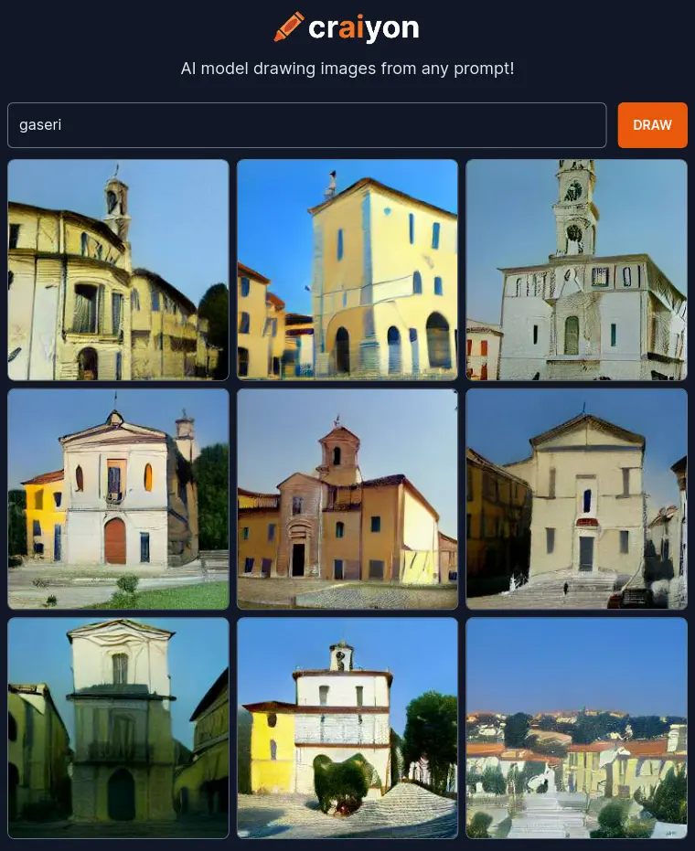

# Često postavljana pitanja

## Na kojem je zavodu Laboratorij za računalne mreže, paralelizaciju i simulaciju?

Na [Zavodu (rus. Заводу) 311](https://battlefield.fandom.com/wiki/Zavod#Zavod_311).

## Завод 311? Znači li to da su vas ruski hakeri haknuli?

Нет.

(Stranice laboratorija servira [Apache](https://httpd.apache.org/), a ne [nginx](https://nginx.org/); ako vam se to čini kao [sasvim proizvoljan odabir jer, eto, mi zasad nismo Google](https://news.ycombinator.com/item?id=14588024), dobro je podsjetiti se da je inicijalni autor nginxa (bolje rečeno, [нгинкса](https://nginx.org/ru/)) poznati ruski haker [Igor](https://youtu.be/YWRYbLKsS0I) [Vladimirovich](https://youtu.be/j9VSQ8UaBnY) [Sysoev](http://sysoev.ru/en/).)

## Zašto CNPSLab nije naveden na [popisu laboratorija FIDIT-a](https://www.inf.uniri.hr/znanstveni-i-strucni-rad/laboratoriji)?

Laboratorij je [ukinut promjenom unutarnjeg ustroja](../index.md#povijest) prilikom [promjene naziva Odjela za infromatiku u Fakultet informatike i digitalnih tehnologija](https://www.inf.uniri.hr/11-hr/naslovnica/915-odjel-za-informatiku-postaje-fakultet-informatike-i-digitalnih-tehnologija).

## Zašto GASERI nisu navedeni na [popisu laboratorija FIDIT-a](https://www.inf.uniri.hr/znanstveni-i-strucni-rad/laboratoriji)?

Mi smo Grupa za aplikacije i usluge na eksaskalarnoj istraživačkoj infrastrukturi (GASERI), a ne Laboratorij za aplikacije i usluge na eksaskalarnoj istraživačkoj infrastrukturi (LASERI).

## Koliko su GASERI jaka institucija?

Druga su najjača institucija na Balkanu, odmah nakon [unuka Bake Praseta](https://youtu.be/8SsrKd_o010).

Iznimka je [kraj rujna, čitav listopad i početak studenog 2022. godine](https://www.index.hr/magazin/clanak/baki-prasetu-vracen-youtube-kanal-s-preko-dva-milijuna-pratitelja/2409371.aspx) dok je [Baki Prasetu bio ugašen kanal](https://n1info.hr/showbiz/baki-prasetu-ugasen-youtube-kanal-s-vise-od-2-milijuna-pratitelja/) i njegovi su unuci bili nešto slabije organizirani pa su tada GASERI bili najjača institucija na Balkanu.

## Ide li GAS NA MAX?

Svakako, [naš voditelj](../ljudi/index.md#osoblje) [GASer docent](hijerarhija-gasera.md#gaser-docent) je na dopustu zbog [usavršavanja NA MAX Plancku](https://www.mpcdf.mpg.de/services/application-support).

## Kako postati gaser?

To je prilično dobro objasnio [DZIMI](https://www.instagram.com/dzimiyt_/) u istonaslovljenom [audiovizualnom uratku](https://youtu.be/7ksQqIOnpnc).

Za one koji traže znanstveniji pristup problemu ili preferiraju pisani materijal pred audiovizualnim, [Maja Sokač](https://www.croris.hr/osobe/profil/41945) iz [Gimnazije Karlovac](https://www.gimnazija-karlovac.hr/) i [Petra Grba](https://www.croris.hr/osobe/profil/42980) iz [Srednje škola Duga Resa](http://ss-duga-resa.skole.hr/) pripremile su znanstveni rad [Reši, đuskati, gaser ili o srbizmima u komunikaciji mladih](https://www.croris.hr/crosbi/publikacija/prilog-skup/734912). Taj je rad dostupan na web sjedištu [Hrvatskoga društva za primijenjenu lingvistiku](https://hdpl.hr/) u dva oblika:

- kao sažetak u [knjizi sažetaka](https://hdpl.hr/knjizice-sazetaka/) [Jezik u digitalnom okruženju, knjiga sažetaka s XXXV. međunarodnog znanstvenog skupa](https://www.hdpl.hr/upload/94623a870a857836d7fb2bfc684d1b1d7bb494cc.pdf#page=120) Hrvatskoga društva za primijenjenu lingvistiku, 2021. i
- kao cjeloviti rad u [zborniku](https://hdpl.hr/zbornici/) [Jezik u digitalnom okruženju, zbornik radova s međunarodnoga znanstvenog skupa](https://www.hdpl.hr/upload/1ad89034ae67554d9e0ff7b298ac93597e54c446.pdf#page=118) Hrvatskoga društva za primijenjenu lingvistiku, 2022.

## Kako postati dio grupe GASERI?

To je nešto manje važna informacija od one u odgovoru na prethodno pitanje pa se nalazi [na posebnoj stranici](../ljudi/kako-se-ukljuciti.md).

## Kako se naziv GASERI prevodi na engleski?

Kako se radi o kratici, ne prevodi se i ostaje [GASERI](../../en/index.md) 😎.

## Kako se riječ gaseri prevodi na engleski?

Trentno nemamo službenu informaciju od autora hrvatsko-engleskog rječnika, Hrvatska TV serija [Sram](https://sram.hr/) u engleskim titlovima koristi prijevod [*clout chasers*](https://www.urbandictionary.com/define.php?term=Clout%20Chaser).

## Može li si ozbiljna institucija dozvoliti da ima emoji kao logo?

Razmotrimo tvrtku [Hugging Face](https://huggingface.co/), autore [Transformersa](https://huggingface.co/transformers), skupa predtreniranih modela za strojno učenje koji ima [68 tisuća zvjezdica na GitHubu](https://github.com/huggingface/transformers). Dosad su [primili 160 milijuna dolara investicija](https://www.crunchbase.com/organization/hugging-face), [procijenjena vrijednost tvrtke iznosi 2 milijarde dolara](https://www.forbes.com/sites/kenrickcai/2022/05/09/the-2-billion-emoji-hugging-face-wants-to-be-launchpad-for-a-machine-learning-revolution/), a njihovo web sjedište ima [19.4 milijuna pogleda mjesečno](https://www.similarweb.com/website/huggingface.co/).

Naravno, mi imamo emoji [Smiling Face with Sunglasses (Cool) 😎](https://emojipedia.org/smiling-face-with-sunglasses/) kao svoj logo prije svega zato što to i jesmo.

## Zašto baš emoji Cool 😎?

Smatramo da je legitimno promatrati društvenu zbilju kako to rade [Prosečni Gaser](https://www.instagram.com/prosecni.gaser/) i [Djak.generacije](https://www.instagram.com/djak.generacije/) pa zbog toga koristiti [Wolf Face 🐺](https://emojipedia.org/wolf/) kao simbol gasera.

Naravno, istovremeno smo svjesni da to nije jedini mogući način promatranja društvene zbilje. Za ilustraciju, razmotrimo jedan drugačiji pogled koji nudi [Nikolina Mitrović](https://www.instagram.com/nika_mitrovicc/) u 4. minuti i 1. sekundi audiovizualnog uratka pod naslovom [10 JE ALI NEMA PARA - NEMA IPHONE 13](https://youtu.be/9w5x622pSc8?t=241) objavljenog na [YouTube kanalu](https://www.youtube.com/@AnjaBla) [Anje Bla](https://www.instagram.com/anjablaa/). Nikolina kaže:

> 10 je ali je gaser😎

Možemo jasno i nedvosmisleno uočiti sraslost pojma gaser i emojija Cool 😎. Ona je ovdje dodatno istaknuta stilskim odabirom izostavljanja razmaka.

## Kako izgleda sastanak grupe?

😎💬😎💬... 😎🤝😎.

## Kada ćete objaviti određeni znanstveni rad/programski kod/skup podataka/audiovizualni uradak?

Uskoro, stvari se rješavaju.

## Zašto se [Matea](../ljudi/index.md#osoblje) na doktoratu bavi ne-kockastim kutijama u simulaciji dinamike biomolekula?

[Svijet je okrugao, a ne kockast.](https://www.mojedete.info/svijet-je-okrugao-a-ne-kockast-emina-hasanbegovic-7-razred/) Stoga i simulacije kretanja nekog dijela (živog) svijeta zahtijevaju podršku za ne-kockaste simulacijske kutije, odnosno riječima pjesnikinje [Nine](https://brainz.center/nina-jerinic-osvojila-drugu-nagradu-na-literarnom-konkursu/) [Jerinić](https://www.osstefandecanski.rs/%D0%B4%D0%B5%D1%87%D1%98%D0%B8-%D0%BB%D0%B8%D1%82%D0%B5%D1%80%D0%B0%D1%80%D0%BD%D0%B8-%D0%BA%D0%BE%D0%BD%D0%BA%D1%83%D1%80%D1%81-%D1%81%D0%B2%D0%B5%D1%82-%D1%98%D0%B5-%D0%BE%D0%BA%D1%80%D1%83/):

> Isključi internet, bar na nekoliko dana,
> uživaj u proleću i mirisu jorgovana,
> posadi kaktus, iako je bockast,
> svet je okrugao, a ne kockast.
>
> Napravi sa drugovima kućicu za ptice,
> dok šetaš kraj reke, nahrani ribice,
> popni se na brdo, vikni na sav glas,
> svet je okrugao, a ne kockast.
>
> Zasadi drvo jer kiseonik daje,
> nek dečija igra u prirodi traje,
> ne diraj ježa jer i on je bockast,
> svet je okrugao, a ne kockast.
>
> I ne zaboravi, zemlja je okrugla,
> pored sebe uvek imaj pravog druga,
> telefon ne oseća, mirise ne širi,
> u okruglom svetu najlepše se živi.

## Zašto je web sjedište grupe tako često ažurirano, a u nastavnim materijalima na predmetu X unutar teme Y nedostaje odjeljak Z koji je zastupljen na predavanjima/vježbama?

Ako smatrate da je u nastavnim materijalima potrebno neke sadržaje proširiti ili drugačije predstaviti, slobodno pretvorite vlastite bilješke s predavanja i/ili vježbi u [format Markdown](../povijest.md#markdown-mkdocs-i-material) i [pošaljite nam prijedlog promjena](../ljudi/kako-se-ukljuciti.md#ukljucivanje-u-nastavni-rad).

## Bojite li se `du -ha`?

Ne bojimo se `du -ha` jer imamo oštrog `ps -a`; ako to ne bude dovoljno, uzet ćemo `top` u ruke i napraviti `killall`.

## Što se petkom navečer radi u Terminalu?

[Terminal](https://www.facebook.com/terminal.club) je daleko pa se nađemo u [GNOME Terminalu](https://wiki.gnome.org/Apps/Terminal) i popravljamo [imenovane cijevi](https://thorstenball.com/blog/2013/08/11/named-pipes/).

## Što je prvi hrvatski predsjednik dr. Franjo Tuđman rekao o prijetnjama slobodi softvera otvorenog koda?

U svom [poznatom govoru](https://hr.wikisource.org/wiki/Govor_Franje_Tu%C4%91mana_u_Zra%C4%8Dnoj_luci_Zagreb_23._studenog_1996.) u [Zračnoj luci Zagreb](https://www.openstreetmap.org/way/142163337) 23. studenog 1996. godine, [dr. Franjo Tuđman](https://hr.wikipedia.org/wiki/Franjo_Tu%C4%91man) je rekao:

> Mi nećemo dopustiti [ostacima vlasničkih Unixa](https://en.wikipedia.org/wiki/Santa_Cruz_Operation), niti Microsofta, stanje kakvo smo bili zatekli u računarstvu uspostavom slobode softvera i otvorenog koda. Nećemo dopustiti da nam sve to dovedu u pitanje. Nećemo to dopustiti tim ostacima vlasničkih Unixa, ali ni onim tehnološkim redikulima, bezglavim smušenjacima koji ne vide o čemu se zapravo radi danas u slobodnom softveru i u svijetu sa kojekakvim GitHub projektima... Nećemo dopustiti onima koji se vežu i s [raznobojnim vragom](https://www.microsoft.com/) protiv slobode softvera i otvorenog koda, ne samo s raznobojnim, nego i [crvenim](https://www.oracle.com/) i [crnobijelim](https://www.apple.com/) vragovima... Nećemo dopustiti onim koji se povezuju sa svima protivnicima slobodnog softvera, ne samo povezuju nego im se nude, ne samo da im se nude nego im se prodaju za [Secure Boot](https://arstechnica.com/information-technology/2015/03/windows-10-to-make-the-secure-boot-alt-os-lock-out-a-reality/), [DRM](https://www.defectivebydesign.org/) i [softverske patente](https://www.eff.org/press/releases/eff-outlines-plan-fix-broken-patent-system), kao što se i sami hvale da dobivaju tehnologiju iz svih laboratorija svijeta, a povezuju se od ekstremista zatvorenosti, do kojekakvih lažnih hipstera, pseudootvorenih obmanjivača koji nam danas propovijedaju velike ideje o pravima korisnika i otvorenim standardima.
>
> Da! [Mi smo stvarali svoju slobodu za prava korisnika i za otvorene standarde](https://www.w3.org/blog/2008/11/w3c-open-web-standards/), ali za prava korisnika prije svega većine korisnika slobodnog softvera. Ali ćemo, razumije se, mi sa tom slobodom softvera i otvorenim kodom osigurati i korisnicima neslobodnog softvera ta prava i otvorene standarde. [Ali nećemo dopustiti da nam ti sa strane rješavaju, odnosno nameću rješenja.](https://www.computerworld.com/article/1646938/microsoft-guns-open-xml-onto-iso-fast-track.html) Slobodan softver neće biti pod kontrolom nijedne kompanije. Unix je dosta bio i pod Berkeleyem i pod AT&T-em, i pod Sunom i pod IBM-om, i pod SGI-em. Zajednica oko Linuxa je izborila svoju slobodu, svoju samostalnost, svoje pravo da sama odlučuje o svojoj sudbini.

## Kako se zovu predstavnici novih generacija okrenuti exaskalarnim superračunalima i isključivo firmiranom hardveru?

<div data-embed-consent="tiktok">
  <p data-embed-placeholder>
    Za prikaz videa ovdje omogućite TikTok videozapise u postavkama kolačića.
    <button type="button" class="md-button embed-cookie-settings">Postavke kolačića</button> ·
    <a href="https://www.tiktok.com/@nikola_replay/video/7090912972452711686">Pogledaj na TikToku</a>
  </p>
  <iframe hidden data-src="https://www.tiktok.com/player/v1/7090912972452711686?description=1&amp;music_info=1"
    title="Video korisnika @nikola_replay na TikToku" style="border: 0; width: 100%; max-width: 325px; aspect-ratio: 9 / 16"
    allow="fullscreen"></iframe>
</div>

## Ima li Grupa za aplikacije i usluge na eksaskalarnoj istraživačkoj infrastrukturi više teleskopa nego Ruđer Bošković?

Naravno da nema, jedino [Bore Balboa](https://youtu.be/x9x0oAcjFNA?t=42s) ima [u kući više teleskopa nego Ruđer Bošković](https://genius.com/23445076).

## Koju distribuciju Linuxa koriste vaše kolege s Ceraka u Beogradu?

Nemamo službenu potvrdu, ali nagađamo da bi to mogao biti [Arch Linux](https://wiki.archlinux.org/title/Arch_Linux) ili barem neka od [distribucija temeljenih na Archu](https://wiki.archlinux.org/title/Arch-based_distributions). Naime, analiziramo li [tekst](https://genius.com/Biba-paris-flow-3-lyrics) [Bibine](https://genius.com/artists/Biba) pjesme [Paris Flow #3](https://youtu.be/XBCNhQqeWs0), nalazimo usporedbu ponašanja djevojke u čijem se društvu nalazi s [Pacmanom](https://wiki.archlinux.org/title/Pacman):

> Ova \[mala\] ​je ko Pacman, jede sve bombonice

``` shell-session
$ pacman --version

 .--.                  Pacman v6.0.2 - libalpm v13.0.2
/ _.-' .-.  .-.  .-.   Copyright (C) 2006-2021 Pacman Development Team
\  '-. '-'  '-'  '-'   Copyright (C) 2002-2006 Judd Vinet
 '--'
Ovaj program može biti slobodno distribuiran
sukladno pravilima GNU General Public License.
```

## Jesu li GASERI u ontološko-fenomenološkom smislu tradicionalni ili moderni?

Oko ovog pitanja u [javnom](https://sh.wikipedia.org/wiki/Dizela%C5%A1i) [diskursu](https://vukajlija.com/gaser) postoje [stanovita](https://www.instagram.com/prosecni.gaser/) [neslaganja](https://znatko.com/17071/tko-je-gaser) pa smo odlučili prepustiti [umjetnoj inteligenciji Craiyon](https://www.craiyon.com/) (ranije poznatoj pod imenom [DALL-E mini](https://github.com/borisdayma/dalle-mini)) da na njega odgovori.



[Slika govori](https://en.wiktionary.org/wiki/a_picture_paints_a_thousand_words) [više nego](https://www.croexpress.eu/hrvatske-narodne-izreke-odabrali-smo-vise-od-60-najzanimljivijih/) [tisuću riječi](https://en.wikipedia.org/wiki/A_picture_is_worth_a_thousand_words) pa je u ovih [više od 9000](https://knowyourmeme.com/memes/its-over-9000) riječi Craiyon jasno svima dao do znanja da su gaseri sastavni dio višestoljetne tradicije.

## Nudite li pristup vašim poslužiteljima putem SSH?

GASERI ne nude pristup putem [SSH](https://www.openssh.com/), već samo putem [SSHH..](https://youtu.be/Fs96WfdspEk).

Za SSH uvijek možete koristiti odredište `localhost`:

``` shell-session
$ ssh localhost
$ hostname
kristina
$ cat /etc/hosts
# Standard host addresses
127.0.0.1  localhost kristina
```

## Koristite li onda barem SSH klijent?

Naravno. Kao dokaz prilažemo sadržaj naše konfiguracijske datoteke `.ssh/config`:

``` shell-session
$ cat .ssh/config
Host 😎.miletic.net
    RemoteCommand /usr/local/bin/gas
```

Ovdje je i sadržaj naše datoteke `.ssh/known_hosts`:

``` shell-session
$ cat .ssh/known_hosts
kristina.host ecdsa-sha2-nistp256 AAAAE2VjZHNhLXNoYTItbmlzdHAyNTYAAAAIbmlzdHAyNTYAAABBBLbqkvnOXPufdOKK1YJHK9br1xbCHeLt5bleW80QeHh0e4CzrBMZ4m6hKMViwHLWUledLuaqbArxxUiGenp25rY=
```

## Sponzorira li vas [Caterpillar](https://www.caterpillar.com/)?

Trenutno ne, ali smo uvijek otvoreni za suradnju. Primjerice, dobro bi nam došao [viličar](https://www.caterpillar.com/en/brands/cat-lift-trucks.html) za furati servere od laboratorija do podatkovnog centra i nazad.

## Sponzorira li vas [Renault Sport](https://en.wikipedia.org/wiki/Renault_Sport)? Imate li službeni [Mégane RS](https://en.wikipedia.org/wiki/Renault_M%C3%A9gane_RS)?

Ne može nas sponzorirati jer je nestao krajem 2021. godine pripajanjem u [Automobiles Alpine](https://www.alpinecars.fr/). Službeni Mégane RS trenutno nemamo, ali priča se po kvartu da se takav auto može koristiti za [službeni put](https://youtu.be/UN5-tPrZMHE) do [Grobnika](https://grobnik.hr/).

## Ako vas ne sponzoriraju ni Caterpillar ni Renault Sport, kako to da ste onda odabrali ovu nijansu oker boje za osnovne elemente web sjedišta?

Mi svakodnevno djelujemo *na granici* poznatih znanja dok provodimo svoja istraživanja. Zbog važnosti te naše misije osjećamo ne samo veliku odgovornost, već i srodnost našeg svakodnevnog zalaganja u znanosti s neprestanom borbom za opstanak glavnih likova iz 2. sezone serije [Južni vetar](https://rezim.rs/), naslovljene *Na granici*. Kako bismo javno izrazili suosjećanje u svakidašnjim naporima, na našem web sjedištu koristi se ista nijansa oker boje kao u pripadnom *teaseru* [Južni vetar: Na granici](https://youtu.be/XE-X4sYwGuI) (engl. [*South Wind: On the Edge*](https://youtu.be/H_5jc49JM0g)). Dodatni je bonus što je u tom *teaseru* za pozadinsku glazbenu temu odabrana pjesma [RASTA X LINK - I DALJE SAM ISTI (OFFICIAL VIDEO)](https://youtu.be/pW5RQRvKIXM), za koju je spot sniman u Rijeci nedaleko [sveučilišnog kampusa](https://www.rijeka.hr/gradska-uprava/gradski-projekti/realizirani-projekti/ostala-velika-ulaganja/kampus-sveucilista-u-rijeci/).
